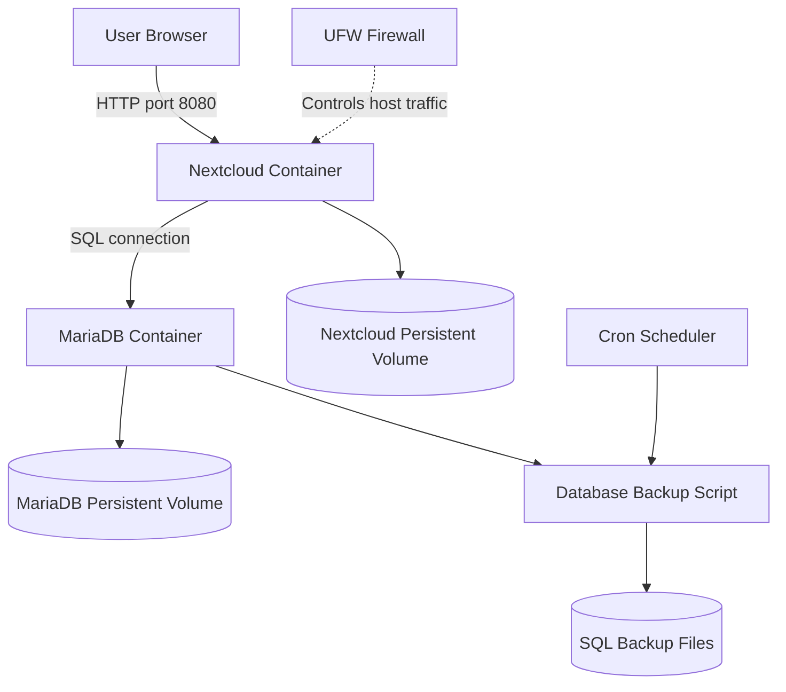

# System Architecture

## Overview

Mission 10 uses a multi-tier application architecture hosted on Ubuntu Server in VirtualBox. Docker Compose manages the Nextcloud application and MariaDB database services.

## Architecture Diagram

## Components

- **Ubuntu Server:** Hosts Docker and the application stack.
- **VirtualBox:** Provides the virtual machine environment.
- **Docker Compose:** Defines and manages the containers.
- **Nextcloud:** Provides the web application interface.
- **MariaDB:** Stores application database records.
- **Persistent volumes:** Preserve data beyond container restarts.
- **Backup script:** Exports database data to an SQL file.
- **Cron:** Schedules the backup script.
- **UFW:** Controls permitted host network traffic.

## Network and Security

Nextcloud is published on host port 8080. MariaDB should communicate with Nextcloud over the internal Docker network and should not be publicly exposed. UFW permits the configured SSH and application ports.

## Data Persistence

Persistent Docker volumes are configured in `docker-compose.yml`. Database exports are stored separately in the project's `backups` directory.

## Notes

The exact container names, volume names, network settings, and port mappings should be verified against the deployed `docker-compose.yml` file.
